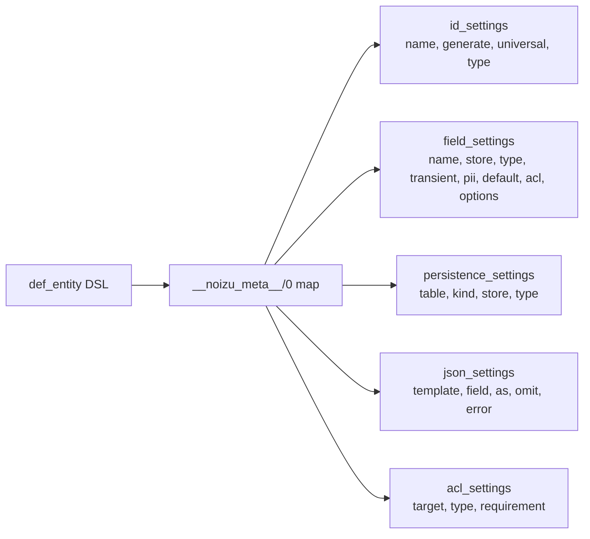

# Project Schema

## Scope

`noizu_labs_entities` is a **library**, not a deployable service. It ships no
relational database, no migrations, and no Liquibase changelogs of its own.
There is therefore **no ERD** in this document (the Mermaid/PlantUML ERD
conventions do not apply). What the library does define is a set of
**structured data shapes**: the compile-time metadata it attaches to entities and
repos, the plugin contracts it consumes (UID providers, UUID libraries, store
adapters), and the small runtime configuration surface.

Consumers own the actual persistence schema (their Ecto schemas, Mnesia/Amnesia
tables, Redis keys). This document describes what this library puts on the wire
between those consumers and their stores.

## Configuration schema

Runtime/compile-time configuration, all under the `:noizu_labs_entities` app.

| Key | Type | Read via | Default | Purpose |
|-----|------|----------|---------|---------|
| `:legacy_mode` | boolean | `Application.compile_env/2` | `false` (set in `config/dev.exs`, `config/test.exs`) | Switches repo inference: off → `MyApp.Users.User` → `MyApp.Users`; on → `MyApp.User` → `MyApp.User.Repo` |
| `:uid_provider` | module | `Application.compile_env/2` | `Noizu.Entity.UID.Default` | Module implementing the `Noizu.Entity.UID` behaviour; changing it requires `mix deps.compile noizu_labs_entities --force` |
| `:uuid_lib` | module | `Application.compile_env/2` | `UUID` (`elixir_uuid`, optional dep) | UUID library that `Noizu.UUID` delegates `uuid5/2,3` and `binary_to_string!/1` to |
| `:umbrella` | boolean | `Application.get_env/2` in `mix.exs` | unset | Selects an in-umbrella `noizu_labs_core` dep over the hex version |

Both `:uid_provider` and `:uuid_lib` are **compile-env** values: they are baked
into the compiled module, so changing them at runtime has no effect.

## Entity metadata (`__noizu_meta__/0`)

`def_entity` compiles all entity configuration into a single map returned by
`__noizu_meta__/0` (accessed through `Noizu.Entity.Meta`). Accessor keys:

| Key | Contents | Record type |
|-----|----------|-------------|
| `:vsn` | entity version (float) | — |
| `:sref` | short-reference string, e.g. `"user"` | — |
| `:repo` | owning repo module | — |
| `:id` | identifier settings | `id_settings` |
| `:fields` | map/list of field settings | `field_settings` |
| `:persistence` | list of persistence layers | `persistence_settings` |
| `:json` | named JSON format templates → field rules | `json_settings` |
| `:acl` | field ACL rules | `acl_settings` |

### `id_settings`

`Record.defrecord(:id_settings, name: nil, generate: true, universal: false, type: nil)`

| Field | Type | Description |
|-------|------|-------------|
| `name` | atom | struct field holding the identifier (defaults to `:id`) |
| `generate` | boolean | whether the repo mints an id on create |
| `universal` | boolean | identifier is unique across the app, not just the table |
| `type` | atom | `:uuid`, `:integer`, `:atom`, `:ref`, or `:dual_ref` — selects the ERP handler |

### `field_settings`

`Record.defrecord(:field_settings, name: nil, store: [], type: nil, transient: false, pii: false, default: nil, acl: nil, options: nil)`

| Field | Type | Description |
|-------|------|-------------|
| `name` | atom | field name on the struct |
| `store` | list | per-store overrides (column name/type mapping) |
| `type` | `{:ecto, type}` \| module \| nil | primitive ecto type, or a typed-field module (e.g. `Noizu.Entity.TimeStamp`) |
| `transient` | boolean | not persisted; ACL-restricted to `[:admin, :system]` |
| `pii` | `false` \| `:sensitive` \| `:private` | PII classification; ACL-restricted to `[:user, :admin, :system]` |
| `default` | term | struct default |
| `acl` | term \| nil | custom ACL requirement override |
| `options` | term \| nil | misc field options |

### `persistence_settings`

`Record.defrecord(:persistence_settings, table: :auto, kind: nil, store: nil, type: nil)`

| Field | Type | Description |
|-------|------|-------------|
| `table` | term | store-specific schema/table module (Ecto schema, Mnesia table, …) |
| `kind` | module | the entity module; auto-set by `def_entity` |
| `store` | term | connection/repo (Ecto repo, Amnesia DB, Redis conn) |
| `type` | module | store adapter module, e.g. `Noizu.Entity.Store.Ecto` |

### `json_settings`

`Record.defrecord(:json_settings, template: nil, field: nil, as: {:nz, :inherit}, omit: {:nz, :inherit}, error: {:nz, :inherit})`

| Field | Description |
|-------|-------------|
| `template` | named format the rule belongs to (`:default` or a custom atom) |
| `field` | field the rule applies to |
| `as` | output key (default: inherit field name) |
| `omit` | whether to drop the field from output |
| `error` | error-handling override |

### `acl_settings`

`Record.defrecord(:acl_settings, target: nil, type: nil, requirement: nil)`

| Field | Description |
|-------|-------------|
| `target` | the field or scope the rule guards |
| `type` | rule kind |
| `requirement` | required role(s), e.g. `[:admin, :system]` |

## Plugin contracts (data interfaces)

These are the shapes the library exchanges with app-supplied modules.

### UID provider — `Noizu.Entity.UID`

| Callback | Returns | Notes |
|----------|---------|-------|
| `generate(repo, node)` | `{:ok, {id, index}}` | `id` becomes the identifier payload; `index` must be in `0..4095` (uuid5 tail) |
| `ref(id)` | `{:ok, ref}` \| `{:error, reason}` | Default provider returns `{:error, {:unsupported, mod, :ref}}` |

`id(:uuid)` identifiers hash `id` into a uuid5 and overwrite its last three hex
digits with `index`. `id(:integer)` identifiers use `id` unchanged.

### Store adapter — `EntityProtocol` + `Entity.FieldProtocol`

| Operation | Meaning |
|-----------|---------|
| `persist(action, entity, table, store)` | write `:create`/`:update` |
| `as_record` / `from_record` | entity struct ↔ store record |
| `fetch_as_entity` / `as_entity` | read store record → entity struct |
| `merge_from_record` | merge record values into an entity |
| `delete_record` | remove from store |

Ecto and Redis adapters additionally expose a `Behaviour` module with default
implementations that entities can `@derive`.

## Test fixtures

`test/support/` holds the sample entities and stubs used by the suite; they are
compiled only under `MIX_ENV=test` (`elixirc_paths(:test)` adds
`test/support`). They model the metadata shapes above and are not production
data.

→ *Code organization: see [PROJ-LAYOUT.md](PROJ-LAYOUT.md) and [layout/lib.md](layout/lib.md)*
