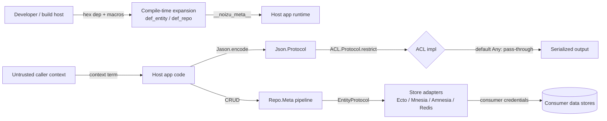

# Threat Model

## Overview

`noizu_labs_entities` is a compile-time code-generation and serialization
library. It exposes **no network surface of its own**: no HTTP routes, no
sockets, no authentication, no secrets handling. Its attack surface is therefore
not a perimeter — it is the **code it injects into the host application** and the
**data-boundary decisions it makes on the host's behalf**.

The three crown-jewel responsibilities are:

1. **Field-level access control (ACL)** — deciding which fields an entity may
   surrender to a caller during JSON serialization.
2. **PII / transient classification** — the metadata that drives (1).
3. **Identifier generation** — minting ids whose uniqueness underpins record
   identity across persistence layers.

Everything else (storage, credentials, transport) is owned by the consuming
application; this library only defines the contracts.

## Trust boundaries

Boundary crossings that matter:

- **Build host → compiled module**: macros expand developer-supplied code at
  compile time (supply chain / build integrity).
- **Host app → serialized output**: this is where ACL must hold; the default
  implementation does not restrict.
- **Host app → store adapters**: CRUD carries entities to/from stores using
  credentials the consumer supplies.

## Attack surface

| Surface | Entry | Notes |
|---------|-------|-------|
| Entity/repo DSL macros | `def_entity`, `def_repo`, `id`, `field`, `transient`, `pii`, `jason_encoder` | Run user code at compile time; produce the metadata that governs runtime |
| JSON serialization | `Jason.Encoder` → `Json.Protocol.prep/4` | Applies ACL before emitting fields |
| ACL protocol | `ACL.Protocol.restrict/5` | Default `Any` impl passes every field |
| CRUD pipeline | `Repo.Meta` before/do/after | Iterates declared persistence layers |
| Identifier generation | `Noizu.Entity.UID`, `Noizu.UUID` | Provider-driven ids; uuid/integer tails |
| sref dispatch | `EntityRepoBehaviour` | Maps sref strings → modules from the application's module list |
| Mix task | `mix nz.gen.entity` | Developer-time file generation from CLI args — not runtime ingress |

## Vulnerability register

| ID | Severity | STRIDE | Component | Status |
|----|----------|--------|-----------|--------|
| T-001 | High | Information disclosure | ACL default `Any` impl passes all fields (`restrict(:read, …)` returns `{:ok, entity}`) | Mitigated by consumer discipline — **partial** (see residual risk) |
| T-002 | Medium | Information disclosure | ACL restriction is opt-in per entity; an entity that never derives/sets ACL rules serializes `transient`/`pii` fields unredacted | Partial — depends on consumer metadata |
| T-003 | Medium | Spoofing | UID provider contract: `index` must be `0..4095`; a provider returning an out-of-range or constant index weakens uuid tail uniqueness | Mitigated by contract; Default provider enforces range |
| T-004 | Low | Spoofing | `Noizu.Entity.UID.Stub` returns `{ms_timestamp, 0}` — two entities of one repo created in the same millisecond collide | Accepted — legacy provider, opt-in only |
| T-005 | Low | Tampering | `EntityRepoBehaviour` builds the sref→module table by scanning application modules; an sref collision maps to an arbitrary module | Mitigated — one module per sref assumed; table built once and cached in `:persistent_term` |
| T-006 | Medium | Elevation of privilege | Compile-time macros expand developer code; a compromised dependency or injected DSL call executes in the build | Accepted — standard Elixir/hex supply-chain model (pin `mix.lock`) |
| T-007 | Low | Information disclosure | `Json.Protocol` omits `nil`, `:"*restricted*"`, and `{:"*restricted*", _}` sentinels; a caller that bypasses `prep/4` and encodes the struct directly skips ACL | Mitigated — encoding path is the generated `Jason.Encoder` |

## Mitigation coverage

- **Mitigated / by design**: T-003 (range contract), T-005 (single cached
  table), T-007 (generated encoder is the path).
- **Partial / consumer-dependent**: T-001, T-002 — the library provides the
  mechanism (per-field `acl_settings`, PII classification) but the default ACL
  implementation is deliberately permissive; enforcement is only as strong as the
  host's `ACL.Protocol` implementation.
- **Accepted**: T-004 (explicit legacy opt-in), T-006 (standard supply-chain
  posture; mitigate by committing `mix.lock` and reviewing dependency updates).

No open items are tracked in this repository's issue tracker as of this writing;
the permissive ACL default is a documented design choice, not a defect.

## Residual risk

The dominant residual risk is **fail-open serialization (T-001/T-002)**. The
`Noizu.Entity.ACL.Protocol` `Any` implementation unconditionally returns
`{:ok, entity}` for `:read`, and field-level restrictions are only applied by an
implementation that reads the compiled `acl_settings` (`transient` →
`[:admin, :system]`, `pii :sensitive`/`:private` → `[:user, :admin, :system]`).
An application that enables `jason_encoder()` but never provides a restricting
ACL implementation will emit fields its authors classified as sensitive. This is
accepted here because the library cannot know a host's role model; consumers must
treat "an entity with `pii`/`transient` fields" as requiring a real ACL impl.

Cross-node id uniqueness is probabilistic (T-003): `UID.Default` ids collide only
if two nodes share the millisecond, counter bucket, random component, and index;
a clock step backwards can mint smaller (but not colliding) ids.
